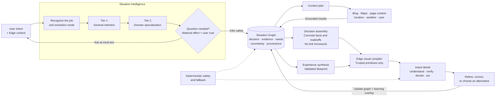

# Microsoft Edge Intent Worlds
### From the browser that helps you search to the browser that helps you finish

## Executive summary

Edge should move beyond **the browser that helps you search** toward **the
browser that understands what you are trying to do—and helps you finish it**.

Today a person turns a goal into queries, opens tabs, reconciles conflicting
pages, and assembles the decision by hand. Copilot can summarize that work, but a
summary still hands the assembly back to the user. **Intent Worlds** closes the
gap: Edge infers the outcome, gathers the current context, assembles the facts
and tradeoffs, and renders them in the shape of the decision—time, space,
proximity, risk, or options—rather than as another page of links.

> **The goal is not another assistant in the browser. It is to make Edge the
> place where Copilot intelligence becomes real-world completion.**

**The ask:** sponsor one time-boxed Edge incubation on five scenarios, built on
the working Intent-to-World reference design, with a single go/no-go gate. The
rest of this document is the case and the architecture behind it.

---

## Why Edge, and only Edge

Copilot supplies the reasoning; Bing supplies fresh web and entity grounding;
Maps supplies geography and routing. **Edge is the only surface that already
holds the context and can take the action**—the pages, tabs, authenticated web
state, location, permissions, forms, and navigation a real task runs through. A
standalone assistant can describe the answer; only the browser can assemble it
in place, let the user verify the source, and carry the handoff to completion.

That is the defensible position: Copilot reasons, Bing and Maps ground, and
**Edge is where reasoning becomes a finished outcome.** A standalone assistant
lacks the browser's context and its ability to act; a browser without a frontier
model lacks the reasoning. Only Edge holds both at once.

---

## What it looks like

Each world reflects the shape of its outcome—not a chat card or a grid of
generic widgets. Airport pickup makes the contrast concrete: today it is five
tabs—flight status, a map, traffic, the airport's curb rules, the weather—that
the user reconciles into a guess about when to leave. Intent Worlds collapses
that into one live journey with a single leave-by time that updates as the
flight and the roads change.

- **Airport pickup** → a live journey: arrival status, terminal geography,
  traffic, weather, curb rules, and a single leave-by time.
- **Local briefing** → a field of nearby changes ordered by reach and impact,
  not publication time.
- **Urgent symptoms** → a safety-first triage surface that leads with what to do
  now and when to escalate.
- **Product research** → a visual comparison of real options, tradeoffs, prices,
  and a recommendation.
- **Real estate** → an aerial place world of pins, listings, amenities, and
  commute time.

```text
Intent → inference → assembled world → refinement → decision → action
```

---

## How it works: the Intent-to-World architecture

The reference design under `src/intent-to-world/` is deliberately structured so
that **reasoning, presentation, and action cannot leak into one another**. Two
engines communicate through a typed, evidence-aware **Situation Graph**. Models
can reason about the world, but Edge owns what is rendered and what can act.

### Architecture at a glance



### Component relationships

| Component | Responsibility | Output |
|---|---|---|
| **Situation Intelligence** | Recognize the latent job, resolution mode, decision, and relevant forces | Initial intention graph |
| **Tier 1 / Tier 2 inference** | Apply general decision structure, then earned domain knowledge | Ranked directions and constraints |
| **Question economics** | Ask only when the answer materially changes the world or handoff | At most two justified questions |
| **Situation Graph** | Hold evidence, provenance, needs, uncertainty, and material effect—never UI | Shared typed contract |
| **Context acquisition** | Retrieve current information within capability and consent boundaries | Grounded graph updates |
| **Decision assembly** | Resolve forces into facts, tradeoffs, and a recommendation | Actionable answer without link homework |
| **Experience Synthesis** | Propose and validate the world shape | Strict, compatible blueprint |
| **Edge visual compiler** | Convert approved blueprints into browser-owned primitives | Safe interactive Intent World |
| **Refinement and learning** | Apply corrections and observed preferences to the graph | A sharper recomputed world |

### The design logic

1. **Recognize the job.** Determine whether the user needs an answer, route,
   comparison, transaction, schedule, field, or safety triage.
2. **Model the intention.** Tier 1 supplies the general decision structure; Tier
   2 adds domain forces such as commute, budget, or health risk.
3. **Protect attention.** A question survives only if it can name what it will
   change and its expected value exceeds its user cost.
4. **Acquire context deliberately.** The graph requests only the Bing, Maps,
   browser, location, or user context needed, with explicit capability and
   consent boundaries.
5. **Assemble, do not delegate.** The response boundary strips URLs and "go
   check" answers when Edge can resolve the information directly.
6. **Compile safely.** Models propose a typed blueprint; Edge validates it and
   renders trusted visual primitives. HTML, CSS, JavaScript, and selectors are
   never model output.
7. **Fail honestly.** Incompatible or unreadable output falls back to a
   deterministic safe world rather than a fabricated experience.
8. **Refine the graph.** Corrections update the decision model and learning
   overlay, not merely the chat transcript. Editing the world becomes the
   conversation.

---

## Local-first hybrid intelligence

Edge should route work between an **on-device model** and a **cloud frontier
model** rather than sending every interaction to the cloud.

> **Do locally what is obvious, private, repetitive, or latency-sensitive. Use
> the cloud for what is ambiguous, current, cross-domain, or
> reasoning-intensive.**

The **local tier** classifies intent, extracts entities and constraints, filters
and redacts personal context, builds the initial graph, matches cached results,
applies simple refinements, and runs deterministic safety rules—rendering a
first useful world immediately while providers and deeper reasoning continue in
parallel. The **cloud tier** is reserved for low-confidence intent, multi-source
synthesis, complex tradeoffs, current-web reasoning, and proposing a blueprint.
Before any escalation, the local tier minimizes what leaves the device: raw
history, page content, identity, and precise location can stay on-device when
structured task features are enough.

| Dimension | Why the tiering wins |
|---|---|
| **Performance** | The first useful state renders without a cloud round trip. |
| **Cost** | Frontier tokens are spent only when complexity and uncertainty justify them. |
| **Privacy** | Sensitive browser context is filtered and abstracted locally, not shipped. |
| **Resilience** | Deterministic worlds keep working through network or cloud failure. |

For safety-critical worlds such as triage, deterministic local escalation must
appear immediately and must never wait for cloud inference.

---

## Safety by construction: urgent triage

Triage shows why the inferred job must govern both reasoning and presentation.
Possible-emergency language gets the highest classification priority, and the
surface is shaped around one decision—**does this need immediate care, and what
do I do now?** It leads with a color-coded severity banner and a prominent
emergency-help action, then immediate steps under **Do this now**, red flags
under **Seek emergency care if…**, calmer explanations visually de-emphasized,
and a standing statement that this is **guidance, not diagnosis**. Unreadable
model output fails toward emergency guidance, never toward reassurance. This is
not a health paragraph inside chat; it is escalation the user cannot miss.

---

## The pilot: five scenarios, one gate

Focus the incubation on five scenarios chosen to stress distinct outcome
shapes—time, space, risk, and tradeoffs—while keeping scope small enough to ship
high quality.

| Scenario | Future Edge experience | Primary value |
|---|---|---|
| **Airport pickup** | Journey World | Unifies route, traffic, arrival processing, and a leave-by time |
| **Local briefing** | Signal Field | Orders nearby change by reach and impact |
| **Urgent triage** | Triage Surface | Makes escalation and immediate action unmistakable |
| **Product research** | Compare Surface | Resolves options, prices, tradeoffs, and a pick |
| **Real estate** | Place World | Combines true geography, listings, amenities, and commute |

**Validation bar (the go/no-go gate).** Intent Worlds must beat today's
search-plus-chat path on the same tasks, at equal or better trust. We will
measure directionally, not against invented targets:

- Time from intent to a confident decision, and share of goals actually completed
- Follow-up searches, tabs opened, and manual comparison work eliminated
- Recovery quality after a misread intent (does refinement fix it in one step?)
- User-reported confidence and trust

**Trust guardrails, tracked as defects:** unsupported claims, hidden provenance,
incorrect high-risk reassurance, unnecessary questions, ignored corrections, and
any action taken without explicit consent. These principles are load-bearing:
*assemble before linking; time and space are first-class; inference reduces
questions; uncertainty stays visible; models propose and Edge compiles; safety
reorders the hierarchy; the open web stays inspectable; actions stay under user
control.*

---

## Business impact

Kept deliberately qualitative—the pilot exists to produce the evidence, not to
assert numbers:

1. **Differentiation:** a browser that completes goals, not one that only
   retrieves or summarizes.
2. **Engagement and retention:** research, refinement, and action stay inside a
   persistent Edge workspace.
3. **Leverage of Microsoft assets:** Copilot reasoning compounds with Bing, Maps,
   browser context, and trusted web actions.

The primary signal remains user value: faster, more confident decisions and more
completed goals.

---

## The decision

**Approve a single, time-boxed Edge incubation** on the five scenarios, staffed
across Edge, Copilot, Bing, Maps, design, safety, and research, built on the
existing Intent-to-World reference design, with **one go/no-go gate** at the
validation bar above.

Edge can understand what a person is trying to do, assemble the world around that
intention, and help them finish it. The reference design proves the architecture
is real; the pilot proves the value.
